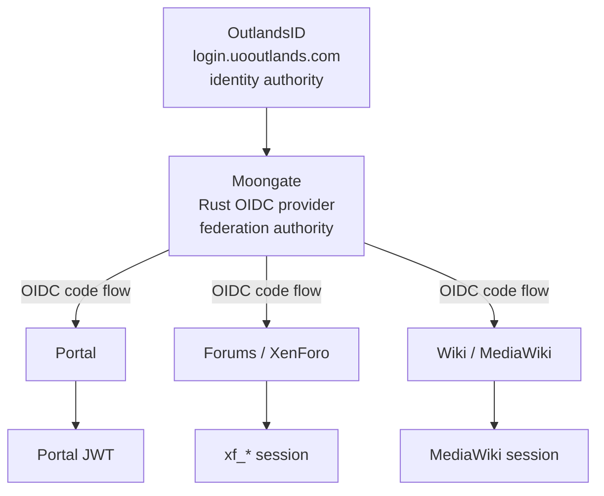

# Moongate architecture

Working design, not a frozen spec.

## Trust model



- OutlandsID is authoritative for the player's identity.
- Moongate is authoritative for federation and its own OIDC subjects.
- Each app is authoritative for its users, usernames, profiles, permissions, content, and
  sessions. Moongate does not replace XenForo or MediaWiki authorization.

**SSO:** the user authenticates upstream once, Moongate creates its own session, and later
`/authorize` requests from other apps reuse that session. Each app then creates its own session.

Logout comes in three distinct kinds that must not be conflated: app logout, Moongate SSO logout,
and upstream OutlandsID logout. Whether Moongate logout also ends the upstream session is an open
decision.

## Observed upstream behavior (unverified assumptions)

Everything here was observed from the client side. None of it is a documented contract.

**OutlandsID JWT claims:** `jti`, `http://uooutlands.com/identity/claims/outlandsid` (stable
numeric id, appears canonical), `.../emailaddress`, `.../role` (e.g. `player`),
`http://uooutlands.com/identity/claims/purpose` (e.g. `Portal`), `exp`,
`iss` = `aud` = `https://login.uooutlands.com`. The `outlandsid` value is a JSON *string*
(`"10001"`), so parse it to `OutlandsId(i64)`. There is no `iat` or `nbf`, so token lifetime and
not-before can't be checked from the claims. The Microsoft/xmlsoap claim URIs suggest an ASP.NET
issuer (assumption). The header is `{"alg":"HS256","typ":"JWT"}` with no `kid`, which means a
symmetric secret held only by Outlands (confirmed 2026-10-04).

**Portal** (`portal.uooutlands.com`): the browser POSTs `{"email", "password"}` as
`application/json` to `/api/user/login`. A success returns `jwt`, `outlandsID`, `email`,
`forceAcceptPrivacyPolicy`, `temporaryToken`, and `privacyPolicyText`, and later API calls use
`Authorization: Bearer <JWT>`. Failures (captured 2026-10-04) return ASP.NET Core
`application/problem+json`: `401 Unauthorized` for a wrong password with a well-formed email, and
`400 Bad Request` for malformed input. Still unverified: what `forceAcceptPrivacyPolicy: true` does
to the `jwt` field.

**Forums** (`forums.uooutlands.com`): local XenForo login (`login`, `password`, `remember`,
`_xfToken`, `_xfRedirect`), `xf_*` cookies.

**Wiki** (`wiki.uooutlands.com`): local MediaWiki login (`wpName`, `wpPassword`, `wpLoginToken`,
...).

## Upstream: what we can and can't know

We can't see what the Outlands team runs internally or what they would be willing to build. We
can only observe their public behaviour and make recommendations. So Moongate has to work against
what is observable today, and anything better is something we propose to them.

**What's realistic today:** the compatibility adapter, decided in
[ADR 0001](adr/0001-outlandsid-compatibility-adapter.md) and implemented in
`src/upstream/outlands.rs`. Moongate shows its own "Sign in with
OutlandsID" form, posts the email and password to the same login API Portal uses, and keeps the
password in memory for that one request only. It then validates the JWT that comes back.

**Trusting the upstream JWT without its signature:** the token is HS256, so Moongate cannot verify
its signature. Its authenticity comes instead from the TLS channel: Moongate itself calls the
Outlands login API over HTTPS with certificate validation and reads the token from that response.
This is the same reasoning OIDC Core §3.1.3.7 gives for skipping the signature check on ID tokens
received directly from the token endpoint. The decision depends on these rules:

- Moongate only trusts an Outlands JWT that it fetched itself in the same request. It never
  accepts an Outlands JWT from a browser, an RP, a form field, or a header. A token from anywhere
  else is unverifiable and must be rejected.
- Still check that the header `alg` is `HS256`, plus `iss`, `aud`, `exp`, `purpose`, and a
  well-formed `outlandsid`. These catch upstream changes rather than forgeries.
- The upstream base URL is fixed in config. It is never derived from request input.
- Drop the raw token once the `UpstreamIdentity` has been extracted.

Record this in an ADR when the adapter is written.

### Recommendations to the Outlands team

Listed from least to most effort on their side:

1. Sign with an asymmetric algorithm (RS256 or ES256) and a `kid`, and publish the public keys as
   a JWKS. Today's HS256 means nobody but Outlands can verify these tokens.
2. Accept a dedicated `purpose`/`aud` value for Moongate, so tokens issued for Portal can't be
   replayed as Moongate logins and the other way round.
3. Offer a redirect-based login. The user signs in on `login.uooutlands.com`, which sends back a
   one-time code that Moongate exchanges server-side. Moongate then never handles the password.
4. Become a standard OIDC provider themselves. Moongate would then be an ordinary OIDC client
   upstream and keep its role for SSO sessions, limiting claims, and linking accounts.

## OIDC surface

```
GET  /.well-known/openid-configuration
GET  /.well-known/oauth-authorization-server
GET  /authorize
POST /token
GET  /userinfo
GET  /jwks.json
POST /revoke
GET/POST /logout
```

Plus liveness (no dependencies) and readiness (checks PostgreSQL). Neither leaks config or errors.
Add introspection only if a client needs it.

Expected clients: `outlands-portal`, `outlands-forums`, `outlands-wiki`. Per-client config:
`client_id`, `client_type`, `redirect_uris`, `post_logout_redirect_uris`, `allowed_scopes`,
`token_endpoint_auth_method`, `enabled`.

Claims: standard first (`sub`, `email`, `email_verified`, `preferred_username`), Outlands extras
namespaced (`https://uooutlands.com/claims/outlands_id`, `.../role`). A client that only needs
`sub` gets only `sub`.

## Data model (starting point)

| Table | Purpose / key constraints |
|---|---|
| `subjects` | `id UUID PK`, timestamps, `disabled_at` |
| `upstream_identities` | `subject_id FK`, `provider`, `provider_subject`, `last_authenticated_at`; `UNIQUE(provider, provider_subject)` |
| `clients` | `client_id UNIQUE`, display name, type, `enabled`, hashed secret |
| `client_redirect_uris` | `client_id FK`, exact `redirect_uri`, `kind` (login / post-logout) |
| `sessions` | token hash, `subject_id`, `authenticated_at`, `last_seen_at`, `expires_at`, `revoked_at`, auth method |
| `authorization_codes` | `code_hash PK`, subject, client, redirect URI, scopes, nonce, `code_challenge`, `expires_at`, `consumed_at` |
| `signing_keys` | `kid`, algorithm, public key, status, activation/retirement times. Private key may live outside PG |
| `audit_events` | timestamp, type, subject, client, actor, correlation id, IP, UA, filtered metadata. No generic request-dump field |
| `application_links` | *maybe*: see "Account linking" below |

Code consumption: `UPDATE authorization_codes SET consumed_at = now() WHERE code_hash = $1 AND
consumed_at IS NULL AND expires_at > now() RETURNING ...`. One statement, no read-check-write.

## Account linking

Existing XenForo and MediaWiki accounts must be kept: posts, edit attribution, groups,
permissions, history. Never create replacement users for linked accounts.

Linking must prove ownership of the existing app account. Matching email is a hint only and is
never sufficient. Linking and unlinking are audited, and unlinking requires recent authentication
and must not strand an account without a recovery path.

New users may create an app account after Moongate authentication (choose a username, the app
creates the user and binds `sub`). They don't get a local password unless there's a reason.

## App integrations

- **XenForo:** OIDC relying party via an add-on that lives outside this repo. It handles redirect,
  callback, token validation, `sub` → user resolution, linking, then a normal XenForo session.
  It holds no Moongate keys or OutlandsID credentials.
- **MediaWiki:** prefer an existing extension (OpenID Connect + PluggableAuth). It must have
  email-based auto-linking disabled.
- **Portal:** it already trusts Outlands-issued bearer JWTs, so migrate in stages: (1) unchanged,
  (2) accepts Moongate login too, (3) Moongate is the normal interactive path, (4) legacy
  interactive login retired if appropriate. Portal may keep its own API bearer tokens.

## Rollout

0. Build Moongate independently; production untouched.
1. Deploy; integrate one low-risk RP; local logins remain.
2. Users link existing accounts (no mass email linking).
3. "Sign in with OutlandsID" becomes the default; local login is kept for recovery.
4. New Forum/Wiki accounts are federated only.
5. Retire local passwords once recovery is proven. Any break-glass admin access is designed and
   documented, not an undocumented bypass.

## Milestones

1. Mocked-OutlandsID Authorization Code + PKCE end to end with a signed ID token. Covers discovery, JWKS, `/authorize`, the Moongate session, PostgreSQL-backed codes, `/token`, `state`, `nonce`, and integration tests.
2. Real OutlandsID federation without Moongate becoming a credential store. In practice this is
   the compatibility adapter, unless Outlands adopts one of the recommendations above.
3. Existing XenForo account linked and logging in via OutlandsID, nothing lost.
4. Same subject linked to an existing MediaWiki account, so Forum and Wiki share SSO.

## Operations

- Deployment: reverse proxy, then the Moongate binary, then PostgreSQL.
- Config from env or mounted secrets: `MOONGATE_BASE_URL`, `DATABASE_URL`,
  `OUTLANDS_AUTH_BASE_URL`, signing-key and session-secret references.
- Dev hosts: `moongate.localhost`, `forum.localhost`, `wiki.localhost` with separate dev clients.
- Sign-in rate limiting is implemented, counting per email and per client IP in PostgreSQL. Set
  `MOONGATE_CLIENT_IP_HEADER` (e.g. `CF-Connecting-IP`) only when every request passes through a
  proxy that overwrites that header; otherwise the TCP peer address is used. Limits on `/token`,
  linking, and admin are still to come. These are a backstop, and upstream stays authoritative
  for credential checks.
- Metrics (request/auth/token counts, latency, active sessions) have no identity labels at all:
  no email, OutlandsID, tokens, or session ids.
- Admin (later): manage clients, redirect URIs, and secrets; inspect and fix links; revoke
  sessions; view audit; rotate keys. Requires stronger authorization than a `player` identity.
- CI: fmt, clippy `-D warnings`, tests, dependency audit. Review security-crate upgrades before
  taking them.

## Threat model

Attackers control every request parameter, cookie, header, JWT (including its header), PKCE input,
`state`, username, and email-like string, and can replay codes and tokens. Also design for a
compromised or malicious relying party, a malicious forum or wiki account, session fixation, login
CSRF, subject/audience/issuer confusion, token substitution, code interception, signing-key or DB
compromise, a malicious admin, and stale app mappings.
